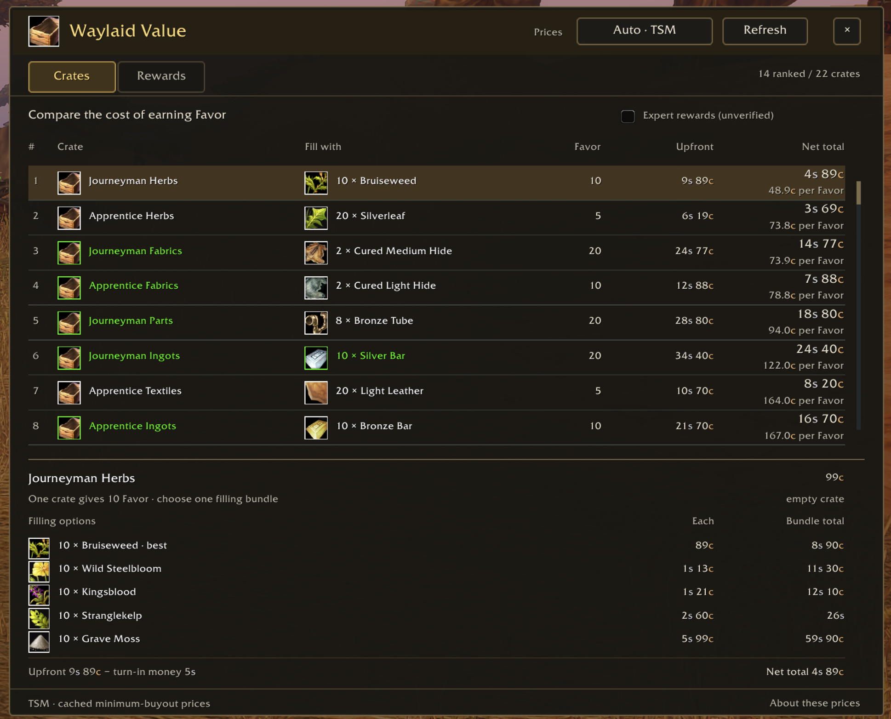
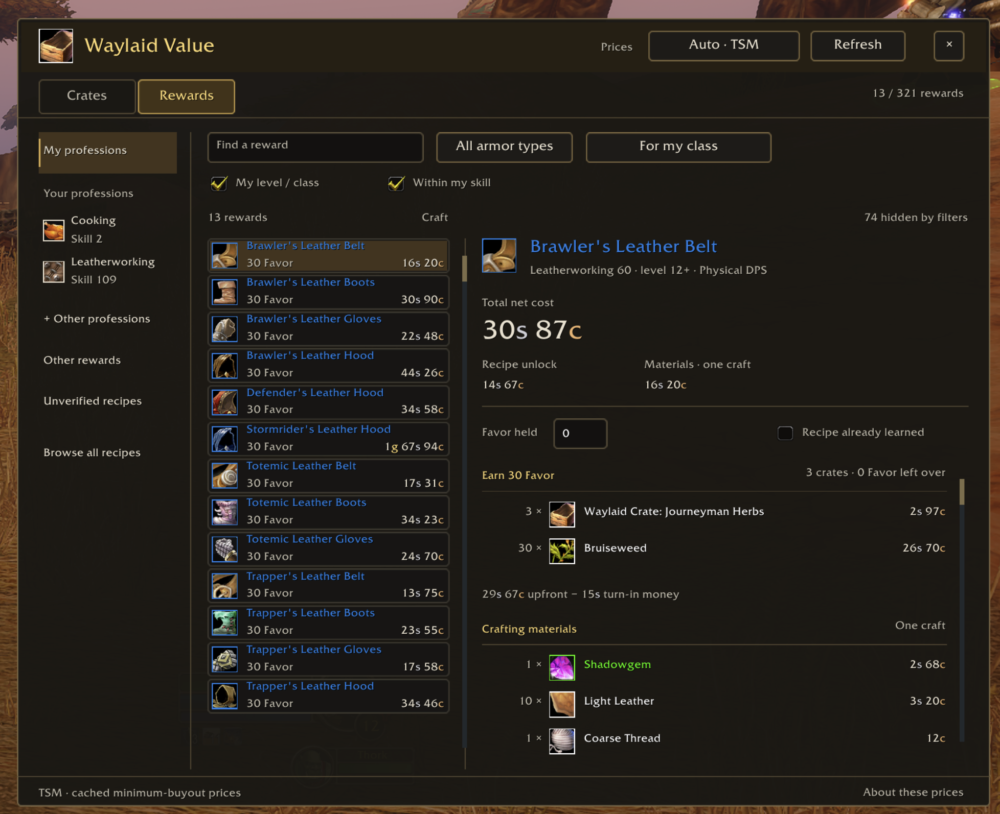

# Waylaid Value

Compare the gold cost of Waylaid Crates and plan Merchant's Favor recipe unlocks in **World of Warcraft: Forever**.

Version **0.6.0 candidate** · Interface **16001** · MIT license

## Candidate status

The public release remains 0.5.4. Version 0.6.0 adds an independently implemented, user-started targeted AH scanner and optional crate item-tooltip sections. The Settings/Scan-button composition is pending design approval; its native panel is not implemented in this checkpoint. The scanner has automated callback coverage but still needs testing in the Forever client.

At the AH, `/crates scan` starts or stops a scan of all catalogue crates and filling materials, plus reagents for the reward currently selected in Rewards. `/crates stop` cancels it. Successful scans select **AH scan** as the price source. Incomplete scans leave the previous snapshot intact. Data stays local, separated by realm and faction.

`/crates tooltip off`, `compact`, `shift` or `always` controls the extra section on crate item tooltips. Shift is the default; hover again while holding Shift to see all filling alternatives. Addon window item tooltips retain their existing breakdown.

Scan quotes are minimum unit-price estimates. They exclude known own auctions but do not establish whole-stack purchase cost, sufficient stock or the cheapest feasible multi-crate purchase route. No buying, bidding, crafting or turn-ins are automated. Auto preserves TSM → Auctionator priority and uses saved scans only for missing quotes.

## What it does

Owned empty crates and filling materials show muted **In bags** counts in Crates. Filling materials show the owned quantity beside the quantity needed for one bundle. This reminder uses the current character’s bags, excludes the bank, and does not change ranking, selection, market costs or Rewards shopping plans.

- Ranks each crate with its cheapest priced filling bundle, total net cost and cost per Favor.
- Shows every accepted filling option, with native item tooltips.
- Browses rewards by profession, armor type, character level/class and crafting skill.
- Builds an exact whole-crate shopping plan for a selected reward, then adds its crafting materials.
- Separates the one-time recipe unlock from the cost of subsequent crafts.
- Reads cached prices from TSM or compatible Auctionator APIs.

Open **`/crates`**, **`/waylaid`**, or the draggable crate icon on the minimap. The window has **Crates** and **Rewards** tabs.

## Install

**WoWUp:** select your Forever client, choose **Get Addons → Install from URL**, and paste `https://github.com/casualg1t/waylaid-value`. Public releases include a Forever ZIP for install and update discovery.

**Manual download:** [latest release](https://github.com/casualg1t/waylaid-value/releases/latest). Choose the ZIP ending in `-forever.zip`.

Download the **WaylaidValue ZIP**, rather than GitHub's source-code archive. Quit WoW, extract the `WaylaidValue` folder into `_forever_/Interface/AddOns/`, and restart. The TOC must be directly inside `AddOns/WaylaidValue/`. When updating, replace the addon folder and retain SavedVariables.

Use **TSM with TSM AppHelper**, or an Auctionator build exposing the v1 price API. OneForAll is not required. Without a price provider, the catalogue remains accessible but costs are unavailable.

## Prices and calculations

**Auto** uses TSM's `dbminbuyout` per item, then Auctionator when a price is missing. Select **TSM** or **Auctionator** to restrict the source. **Refresh recalculates cached prices; it does not scan the auction house.** TSM's public price API used here does not expose the price timestamp. Auctionator ages appear only when its optional age API is available.

Upfront cost = empty crate + one filling bundle. Net cost subtracts the assumed turn-in silver: **50 copper per base Favor**. First-turn-in and random bonuses are excluded. Check actual payouts in game. Unknown/invalid prices stay unavailable. Estimates do not verify stock, full-stack purchase costs, owned materials or vendor alternatives; no buying, crafting or turn-in automation is included.

The catalogue contains 30 crates, 96 filling bundles and 321 assembled rewards. Apprentice/Journeyman rewards are documented; Expert rewards are provisional and opt-in; unknown Artisan rewards remain unranked. Catalogue completeness is not guaranteed.

## Rewards

**My professions** starts with separate **My level / class** and **Within my skill** filters enabled. Expand **Other professions** to inspect an unlearned profession. **Browse all recipes** disables both requirement filters. Search and armor type combine with them. Unverified requirements are counted and do not pass an active requirement filter; turn the filter off to inspect them.

**For my class** also separates role relevance from equip permission. For hunters it keeps physical DPS, general supplies and unclassified items; clearly healing/caster-only gear is hidden. Choose **All roles**, **Physical DPS**, **Spell DPS**, **Healing**, **Tank** or **General** to browse differently. Explicit role choices require a classified match; unknowns remain available under All roles and For my class. Hybrid classes can select a role manually; no talent spec is guessed. These are conservative tooltip-stat affinities, not upgrade rankings. Self-healing supplies and engineering bombs can be general use, while healing-power equipment is healing gear.

Item names and icon borders use the item's rarity, with live-client quality taking precedence over the retained fallback. Currency units use gold/silver/copper colors consistently. The warm rounded controls, framed tabs and reward rows follow the OneForAll design reference while retaining this addon's existing window and tabs. The small skin textures are independently generated project assets; no OneForAll UI source or artwork is included.

The compact reward list shows a full-width item name, Favor price and **Craft** material cost on each row. Craft means one craft's reagents only, excluding the recipe unlock; it does not change with held Favor or the learned-recipe input. Roles remain in the item tooltip and selected detail. A `!` flags a blocked/unverified requirement when browsing outside the active requirement filters. Missing quotes say **Price missing**; direct rewards show a dash because they are not crafted.

Hover controls and menu choices for explanations: tabs, price source, Refresh, filters, professions, held Favor, recipe ownership, cost headings, totals and status messages. Disabled inputs explain how to enable them or why they do not apply. Expert rewards explains the level-20+ crate tier, its unconfirmed 15/30-Favor estimates, and why it is opt-in; reward-shopping plans continue to use documented tiers only. Checkboxes can be hovered/clicked across their labels. Item/effect tooltips remain available on item rows.

The level/class filter checks the finished item, including item-use profession requirements. The skill filter checks the recipe's profession rank. They do not confirm trained weapon proficiency, reputation or recipe ownership. Enter your **Favor held** and check **Recipe already learned** when applicable. Total estimated net cost includes the remaining unlock and one craft, not necessarily one output item.

An observed turn-in of **20 Favor + 10 silver** matches the 50-copper-per-Favor deduction already in the model. It confirms that observation, not every tier or quest bonus. Selected crate/shopping details explicitly subtract **turn-in money** from upfront gold.

## Status and known limits

This is an early public candidate. Automated Lua/JavaScript tests pass, including 963 cross-language reward-cost comparisons. Actual Forever rendering, startup timing, live Auctionator behavior and quest payouts still need field validation. Three recipe prices, one crafting-data entry, a possible tabard gold fee and consumable output yields retain documented uncertainty. Incomplete totals are labelled.

The optional offline report uses a frozen public-item price fixture from **08 Nov 2026, 07:12:13 CET, EU PvP–Horde**. It is not a live market feed. Neither account data nor SavedVariables are part of this repository or the install ZIP.

## Development

Install Lua 5.1, Node.js and Python 3 with Pillow (`python3 -m pip install -r requirements-dev.txt`), then run:

```sh
python3 tools/check.py
```

This builds the ZIP and offline report, runs the Lua and JavaScript suites, and checks catalogue/tooltip facts plus ZIP/source parity. Set `LUA=lua5.1` to select an interpreter. The addon itself has no Python or Node dependency.

Generated files are written to `outputs/` and ignored by Git. Source is in `addon/WaylaidValue/`; public test data is in `fixtures/`. See [validation](docs/VALIDATION.md), [release preparation](docs/PUBLISHING.md), and [changelog](CHANGELOG.md).

`python3 tools/build_ui_preview.py` creates a labelled interactive preview using public frozen fixtures and the actual Lua item facts. It is not a native WoW screenshot. `tools/build_skin.py` regenerates the original 4px-radius skin primitives; `tools/build_eligibility_metadata.py` regenerates requirements, rarity and role fallback facts from the retained tooltip fixture.

## Screenshots





## Credits and licensing

Original addon code is MIT licensed. The reduced ProfessionDB / LibProfessionDB recipe-data extract retains its [MIT notice](addon/WaylaidValue/THIRD_PARTY_LICENSES.txt). Item names, tooltip facts and in-game texture references originate from WoW/Wowhead. Fixture icons and the listing crate icon are game artwork, not covered by the original-code MIT grant. This is an independent community addon, not affiliated with Blizzard Entertainment.
